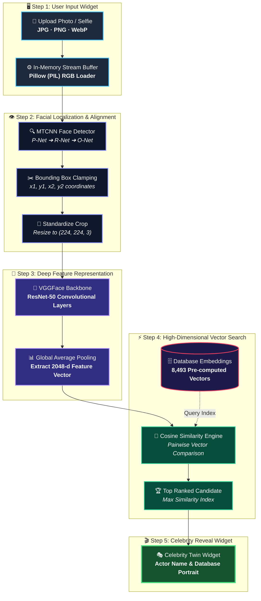

<div align="center">

# 🎬 Bollywood FaceMatch

### *Discover Your Bollywood Celebrity Lookalike with Deep Facial Embeddings*

[](https://huggingface.co/spaces/Aryan22022/bollywood-facematch)
[](https://github.com/CoderAryan29/Bollywood-FaceMatch)
[](https://www.python.org/)
[](https://www.tensorflow.org/)
[](https://gradio.app/)
[](https://opensource.org/licenses/MIT)

<br/>

<p align="center">
  <a href="https://huggingface.co/spaces/Aryan22022/bollywood-facematch" target="_blank">
    
  </a>
</p>

</div>

---

## 🌟 Overview

Have you ever wondered: *"Which Bollywood star do I actually resemble?"*

**Bollywood FaceMatch** is an end-to-end deep learning web application that finds your celebrity twin. Using **MTCNN** for face localization and a deep **VGGFace (ResNet-50)** backbone, it converts facial geometry into rich mathematical embeddings and performs real-time **Cosine Similarity** matching against **8,490+ portraits** of Bollywood's biggest stars.

---

## ⚡ Key Highlights & Features

<table>
  <tr>
    <td width="50%">
      <h3>🎯 Precision Face Localization</h3>
      <ul>
        <li><b>Multi-Task Cascaded CNN (MTCNN)</b> accurately detects faces even with head turns and varied angles.</li>
        <li>Automatic boundary clamping clips background clutter so only facial geometry is evaluated.</li>
      </ul>
    </td>
    <td width="50%">
      <h3>🧠 2048-D Deep Feature Extraction</h3>
      <ul>
        <li>Uses a pre-trained <b>ResNet-50 VGGFace</b> model trained on millions of face identities.</li>
        <li>Global Average Pooling generates a rich, highly discriminative 2048-dimensional feature embedding.</li>
      </ul>
    </td>
  </tr>
  <tr>
    <td width="50%">
      <h3>⚡ Real-Time Vector Similarity Engine</h3>
      <ul>
        <li>Compares facial vectors against <b>8,493 pre-indexed embeddings</b> in sub-second time.</li>
        <li>Uses high-performance <b>Cosine Similarity</b> to measure geometric alignment rather than raw pixels.</li>
      </ul>
    </td>
    <td width="50%">
      <h3>🖼️ Universal Image Format Support</h3>
      <ul>
        <li>Seamlessly handles <b>JPG, JPEG, PNG, and WebP</b> images with instant webcam or upload support.</li>
        <li>Optimized preprocessing pipeline delivers results in under 2 seconds.</li>
      </ul>
    </td>
  </tr>
</table>

---

## 🔬 How the Pipeline Works



### The Math Behind The Match
When a face is cropped and resized, it is converted into a normalized feature vector $\vec{u} \in \mathbb{R}^{2048}$. It is matched against every celebrity embedding $\vec{v}_i$ using **Cosine Similarity**:

$$\text{Similarity}(\vec{u}, \vec{v}_i) = \frac{\vec{u} \cdot \vec{v}_i}{\|\vec{u}\| \|\vec{v}_i\|} = \frac{\sum_{j=1}^{2048} u_j v_{ij}}{\sqrt{\sum_{j=1}^{2048} u_j^2} \sqrt{\sum_{j=1}^{2048} v_{ij}^2}}$$

The celebrity portrait with $\max(\text{Similarity})$ is chosen as your Bollywood twin!

---

## 📊 Dataset Overview

The system matches against an extensive Bollywood facial database:

| Metric | Stat |
|---|---|
| **Indexed Celebrity Images** | `8,493` localized portraits |
| **Unique Celebrities** | `100+` leading Bollywood Stars |
| **Feature Dimensions** | `2048` features per face |
| **Coverage** | Amitabh Bachchan, Shah Rukh Khan, Deepika Padukone, Alia Bhatt, Ranbir Kapoor, Salman Khan, and more |

---

## 🛠️ Technology Stack

<div align="left">
  
</div>

- **Language:** Python 3.8 / 3.11
- **Deep Learning Frameworks:** TensorFlow, Keras, Keras-VGGFace
- **Face Detection:** MTCNN (Multi-task Cascaded Convolutional Networks)
- **Computer Vision & Math:** OpenCV, Pillow (PIL), NumPy, Scikit-Learn
- **Web App UI:** Gradio
- **Cloud Deployment:** Hugging Face Spaces

---

## 🚀 Quickstart & Local Installation

Want to run Bollywood FaceMatch on your own machine? Follow these simple steps:

### 1. Clone the repository
```bash
git clone https://github.com/CoderAryan29/Bollywood-FaceMatch.git
cd Bollywood-FaceMatch
```

### 2. Create and activate a virtual environment
```bash
# Windows (PowerShell)
python -m venv .venv
.\.venv\Scripts\activate

# macOS / Linux
python3 -m venv .venv
source .venv/bin/activate
```

### 3. Install dependencies
```bash
pip install -r requirements.txt
```

### 4. Launch the application
```bash
python app.py
```
Your browser will open automatically at `http://localhost:7860`! 🎉

---

## 🧪 Command-Line Face Matcher

You can test any image directly from the terminal without launching the web interface:

```bash
python test.py
```
*This reads your sample photo, computes cosine similarity across the full dataset, and pops up an OpenCV window showing your matching Bollywood celebrity.*

---

## 📂 Project Architecture

```text
Bollywood-FaceMatch/
│
├── data/                               # Localized celebrity face dataset
│   └── facematcher data/
│       └── Bollywood_celeb_face_localized/
│           ├── bollywood_celeb_faces_0/
│           ├── bollywood_celeb_faces_1/
│           └── bollywood_celeb_faces2/
│
├── sample/                             # Sample images for testing
├── uploads/                            # Temporary upload directory
│
├── app.py                              # Gradio web application & UI
├── feature_extraction.py               # Dataset processing & embedding generator
├── test.py                             # Offline testing and OpenCV viewer
│
├── embeddings.pkl                      # 8,493 pre-computed 2048-d face embeddings
├── filenames.pkl                       # Paths to all indexed celebrity images
│
├── requirements.txt                    # Python environment specifications
└── README.md                           # Documentation
```

---

## 💡 Tips for Best Matching Results

To get an accurate celebrity match:
1. 📸 **Front-Facing:** Look directly at the camera with minimal head tilt.
2. 💡 **Clean Lighting:** Ensure even, balanced lighting across the face.
3. 🕶️ **Clear View:** Avoid dark sunglasses, masks, or hands covering facial features.
4. 👤 **Single Person:** Ensure only one face is visible in the frame for clear detection.

---

## ⚠️ Disclaimer

This project is built for **educational and entertainment purposes only**. Similarity results indicate mathematical resemblance in feature space and do not represent biological or genealogical relations. Celebrity images belong to their respective copyright holders.

---

## 👨‍💻 Author

**Aryan**
* **GitHub:** [@CoderAryan29](https://github.com/CoderAryan29)
* **Project Repo:** [Bollywood-FaceMatch](https://github.com/CoderAryan29/Bollywood-FaceMatch)
* **Live Hugging Face Space:** [Bollywood FaceMatch](https://huggingface.co/spaces/Aryan22022/bollywood-facematch)

<div align="center">
  <br/>
  ⭐ <b>Enjoying the project? Star the repository to show support!</b> ⭐
</div>